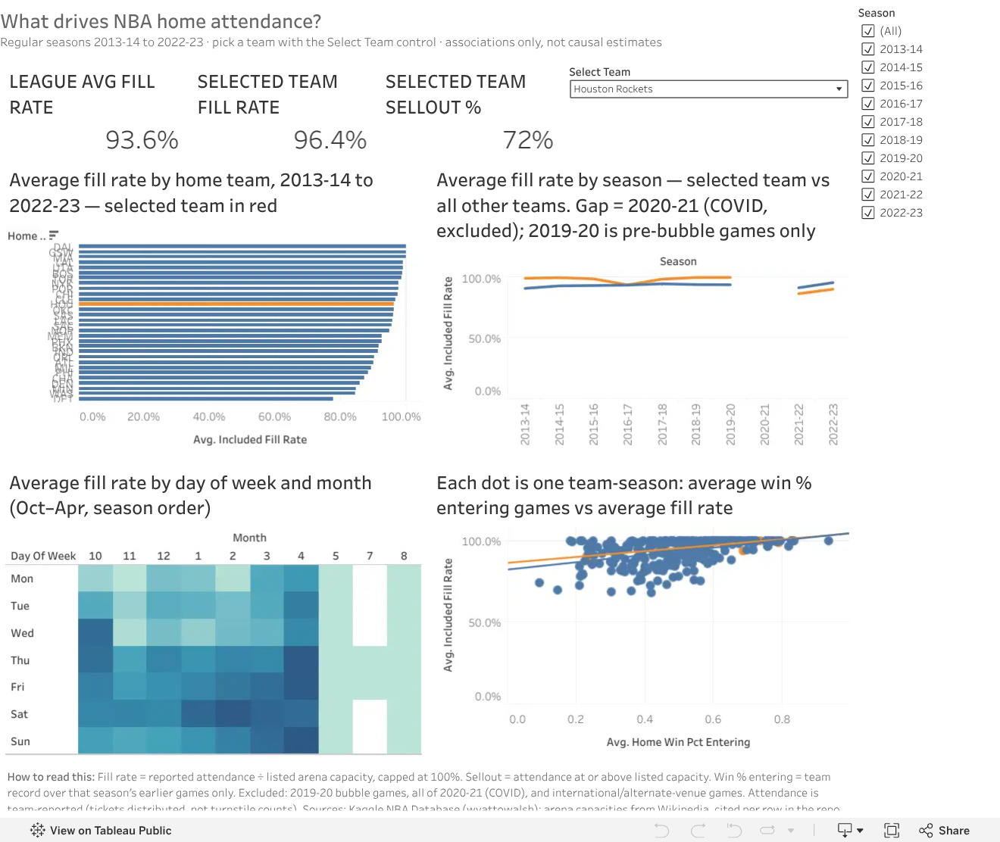

# NBA Home Attendance Analytics


**Question: what is associated with NBA home attendance — and where do the
Houston Rockets sit?**

A SQL + Python + Tableau project covering 11,979 regular-season games
(2013-14 through 2022-23): a reproducible SQLite pipeline, a tested
leakage-free extract, an OLS regression, and an interactive Tableau
Public dashboard. All results are **associations, not causal claims**.

**Dashboard:** [NBA Home Attendance on Tableau Public](https://public.tableau.com/app/profile/alexander.allen6116/viz/NBAHomeAttendance-WhatDrivesFillRate2013-14to2022-23/NBAHomeAttendance)



## Findings

On 9,671 non-excluded games with complete fields (OLS on fill rate =
attendance ÷ capacity, capped at 1.0; R² = 0.167):

1. **Home team quality is the strongest schedule-level association.**
   Entering win percentage 0.100 higher ⇒ fill rate ≈ **+1.7 points**
   (p < 0.001). Visiting-team quality points the same way at about a
   quarter of the size (+0.5 points per 0.100).
2. **The weekend premium is large and precise.** Saturday **+4.9
   points** vs Monday, Friday +4.2, Sunday +3.4 (all p < 0.001); April
   runs +3.7 points above October.
3. **Back-to-backs don't show up at the gate.** −0.15 points, p = 0.59 —
   a genuine null, reported as such.
4. **The Rockets ran at the top of the league, then the rebuild showed
   up at the gate.** Fill ≈ 0.94–1.00 every season through 2019-20
   (100% reported sellout rate in 2018-19), then 0.867 in 2021-22
   (league: 0.914) and 0.903 in 2022-23 (league: 0.956), with reported
   sellouts dropping to ~21%. League-wide, fill tracks home win
   percentage — the association most aligned with filling Toyota Center
   again is a competitive roster.

Details and limitations: [analysis/FINDINGS.md](analysis/FINDINGS.md) ·
data caveats: [DATA_QUALITY.md](DATA_QUALITY.md)

## Metric definitions

- **Fill rate** — reported attendance ÷ listed arena capacity for that
  team and season era, **capped at 1.0** (teams report standing-room and
  suite attendance above listed capacity; the uncapped ratio is kept in
  `fill_rate_raw`).
- **Sellout** — reported attendance ≥ listed capacity.
- **Win % entering** — a team's record over that season's *prior* games
  only; null on season openers. Leakage-tested.
- **Back-to-back** — the home team also played the previous calendar day.
- **Excluded games** — 2019-20 bubble games, all of 2020-21 (COVID
  capacity limits), international games (London/Mexico City/Paris), and
  alternate-venue games (2023 Alamodome). Exclusions are flagged, not
  deleted, so every row stays auditable.

## Data sources

| Source | Used for | License / terms |
|---|---|---|
| [Kaggle "NBA Database" (wyattowalsh/basketball)](https://www.kaggle.com/datasets/wyattowalsh/basketball) | games, attendance (`game`, `game_info` tables) | CC BY-SA 4.0 (dataset page) |
| [Wikipedia arena pages](https://en.wikipedia.org/wiki/List_of_National_Basketball_Association_arenas) | arena capacities by era (every row cited in `data/arena_capacity.csv`) | CC BY-SA 4.0 |
| [Wikipedia NBA Global Games](https://en.wikipedia.org/wiki/NBA_Global_Games) | international / neutral-site game list (verified against the game database itself) | CC BY-SA 4.0 |

Attendance is **team-reported** (tickets distributed, not turnstile
counts). The source database ends June 2023 and is missing the 2012-13
season, which fixes the ten-season window.

## Reproduce

```
pip install -r requirements.txt
python scripts/build_db.py        # downloads nothing; expects nba.sqlite (see below)
python scripts/data_quality.py    # regenerates DATA_QUALITY.md
python -m pytest tests -q         # 16 data-quality + leakage tests
python analysis/regression.py     # regression_results.csv, season_trend.csv
```

The source database downloads free with no Kaggle account:

```
python -c "import os; os.environ['KAGGLEHUB_CACHE']='data/raw/kagglehub'; import kagglehub; print(kagglehub.dataset_download('wyattowalsh/basketball'))"
```

The Tableau workbook is generated, not hand-assembled:
`scripts/extend_workbook.py` writes the sheets/dashboard XML onto a
seed workbook, and `scripts/package_twbx.py` builds the Hyper extract
(via `tableauhyperapi`) and packages the final `.twbx`. Every
calculated field, the parameter, and the table calculation are
documented in [tableau/BUILD_NOTES.md](tableau/BUILD_NOTES.md).

## Repository layout

```
data/            arena_capacity.csv, neutral_site_games.csv (cited reference tables)
  processed/     extract.csv + data_dictionary.md (Tableau-ready, one row per game)
sql/             01-04: commented transformations (game base, entering records,
                 features/exclusions, final extract)
scripts/         build_db.py, data_quality.py, extend_workbook.py, package_twbx.py
analysis/        regression.py, FINDINGS.md, regression_summary.txt
tableau/         seed + generated workbook (.twb/.twbx), BUILD_NOTES.md
tests/           pytest: data-quality checks + independent leakage recompute
.github/         CI workflow running the tests
```

## Limitations

- Attendance is team-reported; several teams report identical sellout
  figures for long stretches.
- Fill rate is capped at 1.0 (≈19% of games report above listed capacity).
- Associations only; pricing, promotions, star players, and market size
  are unmodeled (R² = 0.167 reflects that).
- COVID-affected games (2019-20 bubble, all of 2020-21) and
  international/alternate-venue games are excluded; capacities for
  stable arenas use current listed figures.
